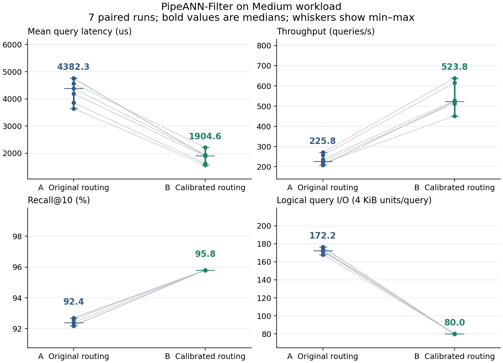

# PipeANN 预过滤路由优化

计算机系统设计课程实验的优化实现。对 PipeANN-Filter 的查询路由增加可配置的选择率阈值，复用已有预过滤路径，降低当前 YFCC Medium 工作负载的查询开销。

基于 [PipeANN 官方仓库](https://github.com/thustorage/PipeANN)，固定提交为 `2ec84fe20c37dc3cc236b66f7eba31c0cc80bf1e`。仅修改 `src/search/spec_filter_search.cpp`，不重建索引。

## 实测结果

2026年11月14日，在同一 WSL2 Ubuntu 22.04 环境、同一100万向量索引上完成7组交替顺序的配对测试。固定 L=40、K=10、threads=1、beamwidth=8、mem_L=0，使用AIO后端。两组各预热一次，不主动清空操作系统或设备缓存。

| Medium 指标，中位数 | 原成本模型 | 校准路由 |
|---|---:|---:|
| 查询延迟 μs | 4382.3 | 1904.6 |
| QPS | 225.8 | 523.8 |
| Recall@10 % | 92.4 | 95.8 |
| 查询逻辑 I/O | 172.2 | 80.0 |

7组 Medium 对照均加速；延迟中位数下降56.54%，QPS提高131.98%，Recall提高3.4个百分点。Low基本不变；High延迟中位数上升0.18%、Recall中位数下降0.2个百分点。优化组峰值RSS范围较大。结论仅适用于已报告的数据、参数、硬件和缓存协议，不承诺其他场景同样加速。



## 查看实现与证据

- [源码补丁](optimization/pipeann_prefilter/prefilter_route.patch)
- [修改后的完整源码文件](optimization/pipeann_prefilter/modified_source/spec_filter_search.cpp)
- [构建脚本](optimization/pipeann_prefilter/prepare.py)
- [配对测试脚本](optimization/pipeann_prefilter/benchmark.py)
- [42条正式测量结果](optimization/pipeann_prefilter/evidence/results.csv)
- [汇总统计](optimization/pipeann_prefilter/evidence/summary.json)
- [环境与运行顺序记录](optimization/pipeann_prefilter/evidence/manifest.json)
- [48次运行的原始日志与命令压缩包](optimization/pipeann_prefilter/evidence/raw_logs.zip)
- [完整优化说明](optimization/pipeann_prefilter/第五章_优化设计与实现.md)

## 复现

先在 Linux/WSL 中按[课程仓库](https://github.com/wfy2003/fvs-course-lab)的说明准备依赖、源码、数据和正式索引，然后将本仓库的 `optimization` 目录复制到课程仓库根目录。在课程仓库根目录执行：

```bash
python3 optimization/pipeann_prefilter/prepare.py \
  --course-root "$PWD" --source "$PWD/systems/PipeANN" --jobs 4

python3 optimization/pipeann_prefilter/benchmark.py \
  --course-root "$PWD" --output "$PWD/course_runs/prefilter-verified-01" --pairs 7
```

输出目录必须尚不存在。准备脚本创建独立的 `systems/PipeANN_prefilter_verified` 目录，遇到已有目录会停止。

环境变量 `FVS_PREFILTER_MAX_SELECTIVITY=0` 保留原成本模型，`0.05` 对估计选择率不高于5%的查询使用预过滤。未设置时默认关闭优化。对照实验使用同一带开关二进制。

原始日志为便于网页上传而压缩。下载 `raw_logs.zip` 并在 `evidence` 目录中解压，可恢复 `evidence/raw/`。本仓库不包含数据集、预构建索引和编译产物。

## 来源与许可证

修改后的源码来自 PipeANN，保留其 [Apache 2.0 许可证](optimization/pipeann_prefilter/modified_source/LICENSE)。补丁体现本实验的路由改动；课程脚本与数据准备遵循原项目说明。
